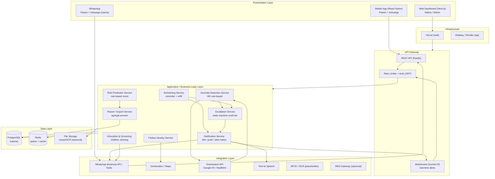
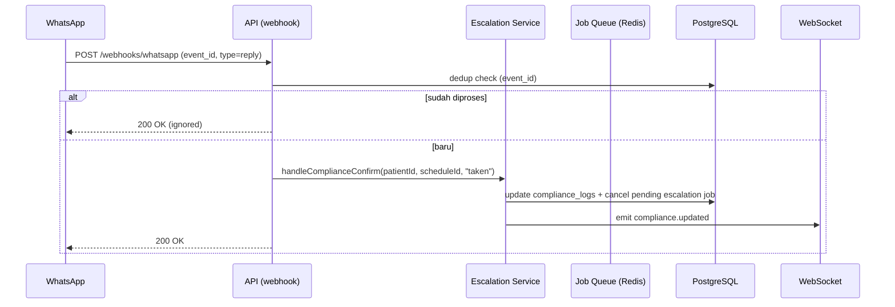
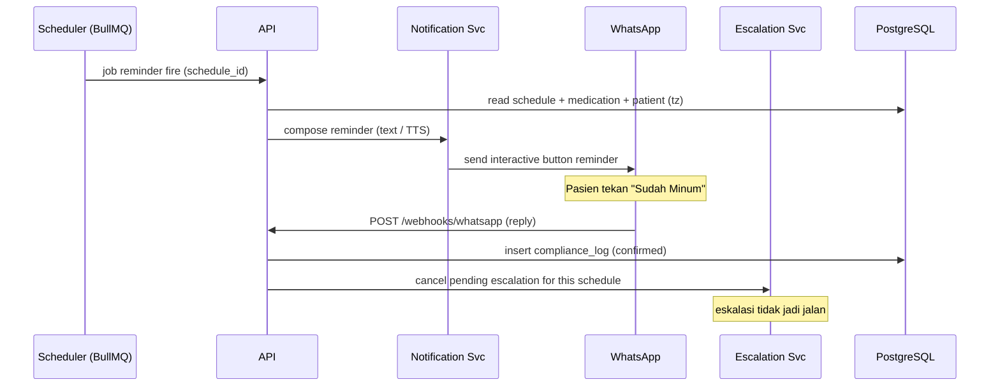
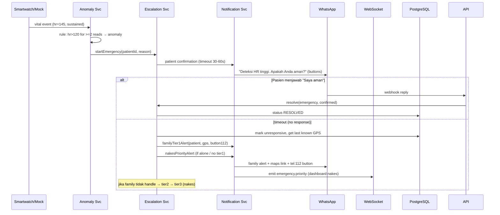
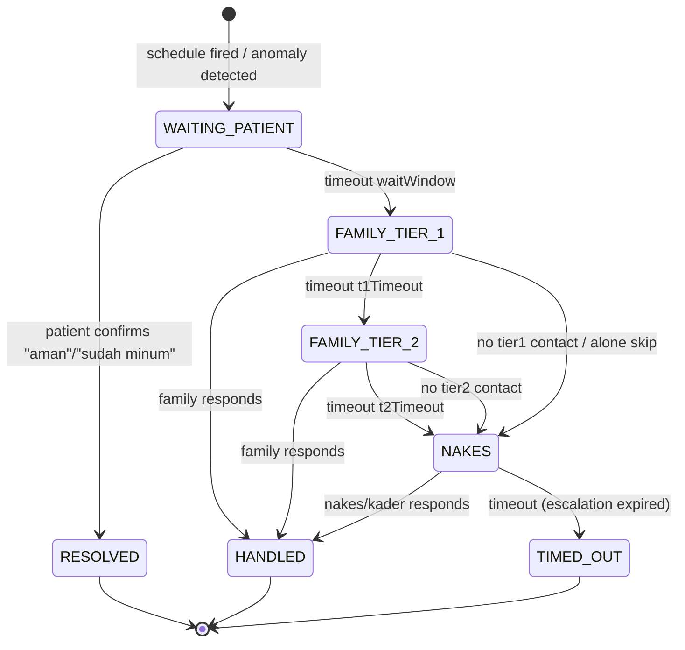

# ARCHITECTURE — Arsitektur Sistem CareLoop

**Versi:** 1.0 · **Scope:** MVP Hackathon (2–4 minggu) · **Terkait:** [TECH_STACK.md](TECH_STACK.md), [DATABASE.md](DATABASE.md), [API.md](API.md)

---

## Daftar Isi

1. [Ringkasan Arsitektur](#1-ringkasan-arsitektur)
2. [Diagram Arsitektur](#2-diagram-arsitektur)
3. [Deskripsi Layer](#3-deskripsi-layer)
4. [Alur Data End-to-End (Flow Kritis)](#4-alur-data-end-to-end)
5. [State Machine Eskalasi](#5-state-machine-eskalasi)
6. [Arsitektur Decision Records (ADR)](#6-arsitektur-decision-records-adr)
7. [Scalability Considerations](#7-scalability-considerations)
8. [Operasional & Monitoring](#8-operasional--monitoring)

---

## 1. Ringkasan Arsitektur

CareLoop dibangun sebagai **modular monolith dengan layanan internal terpisah** (modul dalam satu API server, bukan microservices terpisah). Alasan: kecepatan pengembangan hackathon tanpa mengorbankan batas logika yang jelas. Modul-modul (scheduling, escalation, anomaly, notification, risk, report) dipisahkan secara logis di dalam `apps/api/src/modules/*` dan dapat dipecah menjadi service terpisah di masa depan.

Prinsip kunci:
- **API-driven**: semua akses data lewat REST API + WebSocket untuk real-time.
- **Provider adapter pattern**: WhatsApp, smartwatch, GPS, TTS, SMS — semua via interface agar bisa di-swap/mock.
- **State machine eksplisit** untuk eskalasi (tidak tersebar di handler).
- **Job queue persisten** untuk semua timeout & pengiriman terjadwal (restart-safe).

## 2. Diagram Arsitektur

### Detail webhook & event flow

## 3. Deskripsi Layer

### 3.1 Presentation Layer
- **Web Dashboard (Next.js)** — untuk nakes/admin: monitoring kepatuhan, kelola pasien, alert darurat real-time (WebSocket), export.
- **Mobile App (React Native/Expo)** — pasien: konfirmasi 1-tap, pengaturan smartwatch, profil kontak keluarga; keluarga: alert darurat & tombol 112.
- **WhatsApp** — kanal utama pasien & keluarga. Interaktif buttons untuk konfirmasi & aksi darurat.

### 3.2 API Gateway
- REST API (Fastify) dengan JWT auth + RBAC + rate limiting.
- WebSocket (Socket.IO) untuk push real-time ke dashboard nakes (alert prioritas) dan app pasien/keluarga.
- Single entry point; semua request melewati rate limiter & auth.

### 3.3 Application / Business Logic Layer
Setiap service = modul di `apps/api/src/modules/`:

| Service | Tanggung jawab | Modul |
|---|---|---|
| **Scheduling** | Generate job reminder dari schedule pasien, kelola reschedule, refill estimator | `modules/reminders` |
| **Anomaly Detection** | Terima event vital (smartwatch/mock), rule-based threshold → trigger confirmation | `modules/vitals` + `modules/emergency` |
| **Escalation** | State machine multi-tier (pasien → family T1 → family T2 → nakes); timeout via job queue | `modules/escalation` |
| **Notification** | Komposisi & kirim pesan (WA, push, WS), template, retry | `modules/notification` |
| **Risk Prediction** | Score harian rule-based 0–100, kategori Risiko Rendah/Sedang/Tinggi | `modules/risk` |
| **Report/Export** | Agregat anonim, CSV/JSON, ACL anonimisasi | `modules/export` |
| **Education & Screening** | Chatbot keyword, kuesioner skrining, riwayat skor | `modules/education` |
| **Faskes Nearby** | Query faskes terdekat dari lokasi | `modules/facilities` |
| **Identity/Auth** | JWT, OTP WA, RBAC, profile pasien/keluarga/nakes | `modules/auth` + `modules/patients` + `modules/family` |

### 3.4 Integration Layer
Semua integration di `apps/api/src/integrations/*`, masing-masing punya interface + implementasi nyata + implementasi mock:

- `WhatsAppService` (CL-101) — satu-satunya jalur keluar pesan WhatsApp: `sendText`, `sendTemplate`, `sendInteractive` (tombol `REPLY` untuk konfirmasi 1-tap, tombol `URL` untuk deep-link `tel:112`/maps), `sendAudio`; retry backoff eksponensial (total 3×, FR-1.3). Provider lewat interface `WhatsAppProvider` agar bisa di-swap: `MockWhatsAppProvider` (dry-run + mencatat payload, default `PROVIDER_MODE=mock`) & `MetaCloudApiProvider` (stub — integrasi riil menyusul pasca CL-101).
- `SmartwatchAdapter` — `fetchRecentHeartRate(patientId)`, `subscribeVitalsStream()`. Implementasi: Google Fit API / HealthKit. Mock: generator sintetis + endpoint `/dev/mock-anomaly`.
- `LocationService` — ambil lokasi terakhir tersimpan / resolve geocode; integrasi Maps.
- `TtsService` (CL-106 stub) — `synthesize(text, { locale })` → `{ audioUrl }`. Saat ini hanya `MockTtsService` (URL audio dummy, tidak pernah memanggil vendor); TTS sungguhan menyusul di CL-305. Pemanggil reminder (`modules/reminders/reminder.worker.ts`) memakai stub ini untuk `patients.voice_enabled` (RM-3) dan mencatat kegagalan TTS sebagai baris `reminder_logs` kanal `VOICE` berstatus `FAILED` tanpa menggagalkan reminder teks (RM-4).
- `SmsGateway` (opsional fallback), `BpjsApi` (placeholder stub), `OcrResep` (stub).

### 3.5 Data Layer
- **PostgreSQL** — penyimpanan utama (schema di [DATABASE.md](DATABASE.md)).
- **Redis** — job queue (BullMQ) + cache (dashboard agregat, dedup webhook, rate-limit state).
- **File Storage** — opsional untuk hasil OCR/scan resep.

### 3.6 Infrastructure
- Vercel → web dashboard; Railway/Render → API + worker + cron.
- Supabase PostgreSQL (managed) untuk staging & production; `docker-compose.yml` lokal untuk development.
- `DATABASE_URL` (runtime, boleh connection pooler) dan `DIRECT_URL` (koneksi non-pooler untuk `prisma migrate deploy`) — hanya ada di backend.
- Env via `.env` (lihat [AGENTS.md](../AGENTS.md#environment-variables)).

---

## 4. Alur Data End-to-End

### 4.1 Flow Reminder & Kepatuhan (Fitur 1–3)

**Retry reminder (CL-106).** Retry hanya ada di satu lapis saja: worker reminder
(`modules/reminders/reminder.worker.ts`) mencoba maksimal 3× dan mencatat tiap
percobaan sebagai baris `reminder_logs` (`RETRYING` lalu `FAILED`), memakai
`createWhatsAppService({ maxAttempts: 1 })` agar retry internal `WhatsAppService`
dimatikan. Antrean `reminder` dibuat dengan `defaultAttempts: 1` supaya BullMQ tidak
mengulang job — kalau dua-duanya aktif, satu slot jadwal bisa terkirim 3 × 3 = 9 kali.
Kegagalan TOTAL tidak melempar error (sudah tersimpan di `reminder_logs`), sedangkan
kegagalan pembuatan escalation run sengaja dibiarkan melempar: reminder sudah terkirim
jadi tidak ada risiko kirim ganda, dan pasien yang tidak dikonfirmasi justru butuh
jaring pengaman — kegagalan harus terlihat di antrean, bukan tenggelam.

### 4.2 Flow Darurat Anomali (Fitur 4 + 7)

### 4.3 Flow Eskalasi Bertingkat Lengkap

1. Reminder terkirim, tidak dikonfirmasi dalam **waitWindow** (30 mnt).
2. Tier 1 (keluarga terdekat) dihubungi; timeout **t1Timeout** (15 mnt).
3. Jika tidak ada yang handle → Tier 2 (keluarga jauh); timeout **t2Timeout** (15 mnt).
4. Jika masih tidak ada → Tier 3: nakes/kader terdekat (jaring pengaman, wajib untuk pasien `living_situation=alone`).
5. Siapa pun yang merespons "Saya hubungi pasien / saya tangani" → `HANDLED`, eskalasi berhenti.
6. Semua step tercatat (`escalation_steps`), durasi & hasil dipakai analitik.

---

## 5. State Machine Eskalasi

Status enum (lihat [DATABASE.md](DATABASE.md#eskalasi)):

Aturan implementasi:
- Transisi **hanya** melalui event service yang terdefinisi: `onPatientConfirmed`, `onTimeout`, `onFamilyHandled`, `onNakesHandled`.
- Semua `onTimeout` dijadwalkan sebagai BullMQ job (persisten) saat state masuk.
- `skipFamilyTiers` untuk pasien tanpa kontak keluarga → langsung `NAKES`.
- **Satu `escalation_run` aktif per (patient, context)** — context = `SCHEDULE` atau `EMERGENCY`. Run baru membatalkan run aktif sebelumnya untuk context yang sama (idempotent guard).

---

## 5.b Dependency baru — `expo-secure-store` (mobile)

**Keputusan:** token akses pasien disimpan lewat `expo-secure-store`, bukan
`AsyncStorage` dan bukan memori modul.

**Alasan:**
- Token memberi akses ke rekam medis, jadwal obat, dan akses ke alur darurat. Untuk data
  kesehatan, penyimpanan plaintext di direktori aplikasi tidak dapat diterima.
- `AsyncStorage` hanya terenkripsi di level aplikasi; isinya ikut terbaca dari backup
  perangkat dan dari akses root.
- Memori modul (implementasi sebelumnya) membuat token hilang tiap aplikasi ditutup,
  sehingga pasien harus login ulang setiap kali mau melihat jadwal — tidak layak untuk
  pasien kronis yang memakai ini harian.
- `expo-secure-store` memakai Keychain (iOS) dan EncryptedSharedPreferences (Android),
  sudah jadi bagian dari Expo SDK sehingga tidak menambah native config manual.

**Konsekuensi:** satu dependency native ditambahkan. `AuthScreen` dipakai sebagai
satu-satunya jalan mendapatkan token, dan ada tombol "Keluar" di beranda karena
perangkat sering dipakai bersama di ruang tunggu puskesmas.

**Status:** Implemented (Fase E plan operasional).

---

## 6. Arsitektur Decision Records (ADR)

Format: Status — **Accepted** | Proposed | Superseded.

### ADR-001: Modular monolith alih-alih microservices
- **Konteks**: 2–4 minggu; tim kecil; banyak layanan saling bergantung (eskalasi↔notifikasi↔schedule).
- **Keputusan**: Satu API server dengan modul domain terpisah (`modules/*`).
- **Alasan**: Kecepatan pengembangan, debugging sederhana, transaksi lintas-modul mudah (satu DB).
- **Konsekuensi**: Skala horizontal = scale satu service; akan dipecah bila traffic melebihi kapasitas. Batas modul sudah dipetakan agar pecahnya mudah.
- **Status**: Accepted.

### ADR-002: WhatsApp sebagai kanal utama pasien (bukan native app first)
- **Konteks**: Lansia Indonesia familiar WA; barrier install app tinggi; keluarga jauh juga pakai WA.
- **Keputusan**: Interaksi pasien utama via WhatsApp Business API (interactive buttons). Mobile app jadi pendukung (smartwatch sync, tombol darurat besar).
- **Alasan**: Adopsi tinggi, zero-learning untuk target user; eskalasi ke keluarga jauh juga lewat WA.
- **Konsekuensi**: Bergantung kebijakan Meta (template approval, 24h window). Sandbox sejak awal. Provider di-enkapsulasi (`WhatsAppService`) agar bisa swap (360dialog, Twilio, atau bot WA biasa untuk demo).
- **Status**: Accepted.

### ADR-003: Job queue persisten (Redis/BullMQ) untuk timeout & scheduler
- **Konteks**: Timeout eskalasi & reminder tidak boleh hilang saat server restart/redeploy.
- **Keputusan**: Semua delayed job via BullMQ (Redis). State eskalasi di PostgreSQL, bukan di memori.
- **Alasan**: Durability & observability; mudah retry.
- **Konsekuensi**: Butuh Redis sebagai dependency; default `docker-compose`. Fallback sederhana: DB-poller `schedules` (untuk kasus tanpa Redis) — dipilih saat demo offline.
- **Implementasi**: `apps/api/src/lib/queue.ts` (`BullMqQueue` — restart-safe, `schedule`/`cancel`/`retry`, idempotent via `jobId`).
- **Status**: Implemented (CL-104).

### ADR-004: Real-time alert via WebSocket (Socket.IO) untuk dashboard nakes
- **Konteks**: Nakes butuh alert darurat instan; polling REST boros & lambat.
- **Keputusan**: WebSocket server (Socket.IO) di API; dashboard subscribe per scope puskesmas/wilayah.
- **Alasan**: Latency < 1 detik untuk alert prioritas; murah untuk skala MVP.
- **Konsekuensi**: Manage koneksi & re-auth; untuk skala besar bisa diganti SSE/MQ (MQTT/Kafka) — di luar scope MVP.
- **Status**: Accepted.

### ADR-005: Eskalasi multi-tier dengan kontak keluarga terpisah per pasien
- **Konteks**: Keluarga bisa banyak & tersebar (dekat & jauh); keluarga terdekat mungkin tidak ada.
- **Keputusan**: `family_contacts` terpisah dari `users`; tiap pasien punya daftar tier + prioritas + zona (dekat/jauh) + status aktif. Nakes sebagai tier cadangan (system-level, bukan kontak keluarga).
- **Alasan**: Fleksibel, mendukung skenario lansia tanpa keluarga dekat, dan kebutuhan "alihkan ke nakes" yang otomatis.
- **Konsekuensi**: Butuh penanganan data kontak (PII) dengan enkripsi & consent (lihat [SECURITY.md](SECURITY.md)).
- **Status**: Accepted.

### ADR-006: Deteksi anomali rule-based (bukan ML)
- **Konteks**: MVP; ML butuh dataset & waktu training; hasil harus dapat dijelaskan saat demo.
- **Keputusan**: Threshold rule: HR < 50 atau > 120 bpm selama ≥ 2 bacaan berurutan dalam 60 detik (konfigurable per pasien). Tidak ada model.
- **Alasan**: Deterministik, mudah diuji (unit test), mudah dijelaskan juri.
- **Konsekuensi**: Potensi false positive lebih tinggi → mitigasi dengan konfirmasi pasien sebelum eskalasi.
- **Status**: Accepted.

### ADR-007: Seluruh waktu disimpan UTC; zakat/zona waktu di profil pasien
- **Konteks**: Pasien lintas zona (WIB/WITA/WIT); scheduler harus akurat.
- **Keputusan**: `timestamptz` (UTC) di DB; profil menyimpan `timezone` (default `Asia/Jakarta`).
- **Alasan**: Mengurangi bug reminder lintas zona.
- **Konsekuensi**: Selalu konversi saat komposisi pesan & render UI.
- **Status**: Accepted.

### ADR-008: Panggilan 112 = tombol one-tap call (BUKAN auto-dial)
- **Konteks**: Auto-dial tidak feasible secara teknis & etis/legal di platform pihak ketiga (browser/WA/PWA membatasi; risiko abuse).
- **Keputusan**: Menyediakan deep-link `tel:112` yang harus ditekan manual oleh pasien/keluarga. Tidak ada kode yang memicu panggilan otomatis.
- **Alasan**: Keselamatan & kepatuhan; tetap memenuhi kebutuhan "satu ketukan untuk memanggil bantuan".
- **Konsekuensi**: Pada demo, sebutkan bahwa deep-link adalah standar pembatasan platform; fokus nilai = otomasi **deteksi + eskalasi**, bukan dial.
- **Status**: Accepted.

### ADR-009: Auth pasien via WhatsApp OTP / phone-based (bukan email/password)
- **Konteks**: Lansia tidak mau mengingat password; login utama = nomor HP yang terdaftar.
- **Keputusan**: OTP via WhatsApp untuk pasien/keluarga; username+password untuk nakes (dashboard).
- **Alasan**: Sesuai kebiasaan pengguna (satu-tap), tingkat keamanan cukup untuk MVP dengan rate-limit OTP.
- **Konsekuensi**: Butuh rate limiting OTP & daftar nomor terverifikasi; 2FA opsional nanti.
- **Status**: Accepted.

### ADR-010: Redis sebagai cache + queue (opsional saat demo offline)
- **Konteks**: Railway/Render versi gratis terbatas; demo bisa offline.
- **Keputusan**: Dependency Redis dipakai bila tersedia; jika tidak, fallback DB-poller scheduler + in-process queue sederhana (tidak disarankan untuk production, cukup demo).
- **Alasan**: Menjaga demo tetap jalan tanpa infrastruktur tambahan.
- **Konsekuensi**: Implementasi queue dibuat abstraksi (`JobQueue` interface) dengan 2 implementasi: `BullMqQueue` (default) & `InProcessQueue` (demo).
- **Implementasi**: `apps/api/src/lib/queue.ts` — `createJobQueue` memilih `bullmq` bila `REDIS_URL` terisi, selain itu `in-process`; `registerQueueLifecycle` menutup worker+queue saat server stop.
- **Status**: Implemented (CL-104).

---

## 7. Scalability Considerations

Scope MVP: ~10k pasien. Kebutuhan skala berikutnya dipetakan, bukan dibangun:

| Aspek | Saat ini (MVP) | Jalan ke skala |
|---|---|---|
| Scheduler | BullMQ satu worker | Partition per wilayah/puskesmas; consumer group |
| WhatsApp throughput | 1 token/nomor bisnis | Multi-number / provider routing, template rate limit Meta |
| DB | 1 PostgreSQL | Read replica untuk dashboard; partisi `compliance_logs` & `vital_signs` per bulan |
| WebSocket | 1 instance Socket.IO | Redis adapter untuk multi-instance; fallback SSE |
| Anomaly ingest | REST per event | Stream/queue ingest (Kafka/NATS) saat volume besar |
| Dashboard agregat | Query langsung + cache Redis | Materialized view / cube olap |
| Export | Job synchronous kecil | Background job + object storage |
| Layanan internal | Modul | Dipisah per domain (escalation, notification) bila perlu |

**Prinsip**: jangan bangun infrastruktur besar di MVP. Pastikan **abstraksi & batas modul** memungkinkan perpecahan tanpa rewrite.

## 8. Operasional & Monitoring

- **Log**: structured JSON (pino), trace id per request (`x-request-id`).
- **Metric MVP**: reminder sent/failed, confirmation latency, escalation time-to-handle, anomaly count, false-positive rate, WS connections.
- **Alert**: tidak perlu tooling berat — dashboard sederhana `/health` + log review; untuk demo, gunakan log panel Railway/Render.
- **Recovery**: job queue persist memastikan eskalasi yang tertunda dieksekusi ulang setelah restart. Webhook idempoten. DB backup harian (disediakan platform deploy).
- **Health check**: `/healthz` = liveness (proses hidup saja, tidak menyentuh dependency). `/readyz` = readiness (database, Redis, dan versi migration; `503` bila ada yang gagal). Platform deliver harus memakai `/healthz` untuk restart policy dan `/readyz` untuk load balancer. Lihat [docs/DEPLOYMENT.md](DEPLOYMENT.md).
