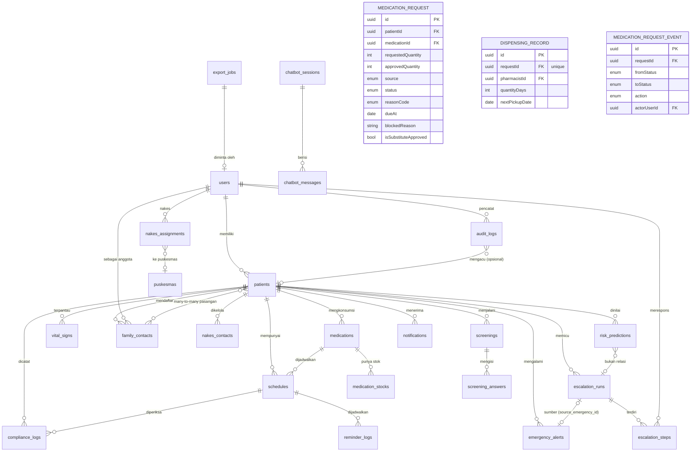

# DATABASE — Skema & Desain Database CareLoop

**Versi:** 1.0 · **DB:** PostgreSQL 16 + Prisma · **Terkait:** [ARCHITECTURE.md](ARCHITECTURE.md), [API.md](API.md)

---

## 1. Prinsip Desain

- **Satu DB PostgreSQL** sebagai sumber utama (monolith module). Redis hanya untuk queue & cache — **bukan** sumber kebenaran.
- Semua tabel waktu: `timestamptz` (UTC). Kolom waktu diakhiri `_at`.
- Enum & status: **string enum** (bukan angka) untuk keterbacaan.
- **Soft delete** dihindari — data klinis/pemantauan bersifat append-only; gunakan `status` dan `deleted_at` bila perlu.
- Sensitive data (NIK, no HP, lokasi presisi, vital detail) ditandai — lihat [SECURITY.md](SECURITY.md) untuk enkripsi.
- ID: `uuid` default (Prisma `@default(uuid())`); kolom referensi uuid.

## 2. ERD



> Catatan: `family_contacts` dapat dipandang sebagai relasi pasien–keluarga dengan metadata tier/prioritas. Karena satu `user` bisa jadi keluarga untuk banyak pasien, gunakan model pivot (di bawah) dengan `user_id` nullable saat kontak belum punya akun (hanya nomor HP).

## 3. Daftar Tabel

### 3.1 `users`
Akun semua aktor (pasien, keluarga, nakes, admin). Profil spesifik dipisah di tabel role.

| Kolom | Tipe | Deskripsi |
|---|---|---|
| id | uuid PK | |
| phone | varchar(20) unique | Nomor HP (login utama) — **encrypted at rest** |
| email | varchar(255) nullable unique | Opsional (nakes/admin) |
| password_hash | text nullable | Untuk nakes/admin (pasien pakai OTP WA) |
| full_name | varchar(120) | |
| role | enum `PATIENT` `FAMILY` `NAKES` `ADMIN` | |
| nakes_role | enum nullable `DOKTER` `PERAWAT` `BIDAN` `KADER` `LAINNYA` | Hanya untuk role `NAKES` — kewenangan klinis |
| language | varchar(10) default `id` | |
| timezone | varchar(32) default `Asia/Jakarta` | ADR-007 |
| is_active | bool default true | |
| is_verified | bool default false | Verifikasi OTP |
| consent_pdp_at | timestamptz nullable | Persetujuan data (UU PDP) |
| created_at / updated_at | timestamptz | |

> **`nakes_role` nullable tanpa default.** Kolom ini menentukan siapa yang boleh menyetujui
> resep dan menetapkan ambang detak jantung, jadi tidak diberi nilai default di database —
> peran klinis hanya terisi bila admin memilihnya saat membuat akun. Akun non-`NAKES`
> membiarkannya kosong. (Kolom ini sempat diberi `DEFAULT 'PERAWAT'` dan sudah dikoreksi lewat
> migrasi `fix_nakes_role_default`, karena default tersebut ikut menempel ke akun pasien,
> keluarga, dan admin.)

### 3.2 `patients`
Profil klinis & demografi pasien (ekstensi `users.role=PATIENT`).

| Kolom | Tipe | Deskripsi |
|---|---|---|
| id | uuid PK **dan** FK → users.id | 1:1 dengan user; tidak ada kolom `user_id` terpisah |
| nik | varchar(16) nullable unique | **Encrypted at rest** |
| date_of_birth | date | |
| gender | enum `M` `F` | |
| address | text nullable | |
| district_code | varchar(10) | Kode kelurahan/kecamatan untuk filter wilayah |
| city / province | varchar(80) | |
| status | enum `ONBOARDING` `ACTIVE` `INACTIVE` `BLOCKED` default `ONBOARDING` | **Hanya `ACTIVE` boleh diproses scheduler.** Status lain tidak menerima reminder, konfirmasi, maupun eskalasi |
| primary_puskesma_id | uuid nullable FK → puskesmas.id `ON DELETE SET NULL` | Puskesmas penanggung jawab utama. Sumber kebenaran cakupan pasien |
| activated_at | timestamptz nullable | Waktu status naik ke `ACTIVE` |
| activated_by_id | text nullable | User yang mengaktifkan (dokter/bidan/admin) |
| deactivated_reason | text nullable | Alasan saat status turun ke `INACTIVE`/`BLOCKED` |
| living_situation | enum `ALONE` `WITH_FAMILY` `FAR_FROM_FAMILY` `OTHER` | Kunci jalur eskalasi nakes |
| has_nearby_family | bool default true | Fast-track eskalasi nakes |
| emergency_preference | enum `FAMILY_FIRST` `NAKES_FIRST` | Urutan eskalasi darurat |
| health_conditions | text[] | Array penyakit kronis (diabetes, hipertensi, tbc…) |
| bpjs_number | varchar(20) nullable | **Encrypted**; placeholder integrasi BPJS |
| smartwatch_enabled | bool default false | |
| voice_enabled | bool default false | Voice reminder (TTS) |
| device_push_token | text nullable | Push app |
| last_known_location | point nullable | GPS terakhir (darurat) |
| last_location_at | timestamptz nullable | |
| risk_score | int nullable | Cache skor risiko (job harian) |
| risk_level | enum nullable `LOW` `MEDIUM` `HIGH` | |
| hr_min_bpm | int nullable | Ambang bawah detak jantung individual; NULL = pakai `ANOMALY_HR_MIN` |
| hr_max_bpm | int nullable | Ambang atas; NULL = pakai `ANOMALY_HR_MAX` |
| created_at / updated_at | timestamptz | |

> `hr_min_bpm` / `hr_max_bpm` ditetapkan dokter atau bidan. Sebelumnya ambang ini dititipkan
> sebagai teks bebas di `health_conditions` (mis. `"max_hr:130"`) lalu diparse regex; format
> bebas tidak bisa diaudit maupun dibedakan mana yang disahkan dokter.

#### Prasyarat aktivasi (`status = 'ACTIVE'`)

Status naik hanya lewat `POST /v1/patients/:id/activate`, dan hanya bila seluruh
prasyarat berikut terpenuhi. Checklist dihitung ulang di server pada setiap pemanggilan —
UI hanya menampilkan, tidak memutuskan (guardrail flow §3).

| Prasyarat | Sumber data |
|---|---|
| Puskesmas utama ditunjuk dan aktif | `primary_puskesma_id` + `puskesmas.is_active` |
| Persetujuan PDP tercatat | `users.consent_pdp_at` |
| Persetujuan berbagi dengan nakes | `consent_share_with_nakes` |
| Nomor WhatsApp terverifikasi | `users.is_verified` |
| Data minimum lengkap | nama, nomor, tanggal lahir, gender, `district_code`, `health_conditions[]` |
| Minimal satu tujuan eskalasi | `family_contacts` atau `nakes_contacts` yang `is_active` |
| Minimal satu resep disetujui | `medications.status = 'APPROVED'` |
| Minimal satu jadwal aktif | `schedules.is_active AND schedules.status = 'APPROVED'` |

Keputusan aktivasi hanya boleh diambil `DOKTER`, `BIDAN`, atau `ADMIN`. Perawat dan kader
boleh melengkapi data dan membuat draft resep, tetapi tidak boleh menaikkan status —
itu keputusan klinis. `PATCH /v1/patients/:id/status` menolak tujuan `ACTIVE` supaya
checklist tidak bisa dilewati.

Transisi yang sah:

```text
ONBOARDING → ACTIVE | INACTIVE | BLOCKED
ACTIVE     → INACTIVE | BLOCKED
INACTIVE   → ONBOARDING | ACTIVE | BLOCKED
BLOCKED    → ONBOARDING | INACTIVE
```

### 3.3 `puskesmas` (dan `facilities`)
Faskes & puskesmas tempat pasien terdaftar / lokasi nakes.

| Kolom | Tipe | Deskripsi |
|---|---|---|
| id | uuid PK | |
| name | varchar(150) | |
| type | enum `PUSKESMAS` `PUSKESMAS_PEMBANTU` `RUMAH_SAKIT` `KLINIK` `APOTEK` | |
| district_code | varchar(10) | |
| address | text | |
| phone | varchar(20) | |
| lat / lng | double precision | |
| is_active | bool | Nonaktif = tidak boleh dipilih untuk pasien/staf baru |

`patients.primary_puskesma_id` menunjuk ke tabel ini; kolom dibiarkan nullable supaya
puskesmas yang dinonaktifkan tidak cascade menghapus riwayat pasien.

### 3.4 `nakes_contacts`
Tenaga kesehatan/kader yang menangani pasien (jalur eskalasi tier 3).

| Kolom | Tipe | Deskripsi |
|---|---|---|
| id | uuid PK | |
| patient_id | uuid FK → patients | |
| nakes_user_id | uuid nullable FK → users | Nullable jika belum punya akun (hanya kontak WA) |
| nakes_name | varchar(120) | |
| nakes_role | enum `DOKTER` `PERAWAT` `BIDAN` `KADER` `LAINNYA` | |
| phone | varchar(20) | **Encrypted** |
| puskesmas_id | uuid FK → puskesmas nullable | |
| is_primary | bool default false | Jalur utama nakes |
| is_active | bool | |
| created_at | timestamptz | |

### 3.5 `medications`
Obat yang dikonsumsi pasien.

| Kolom | Tipe | Deskripsi |
|---|---|---|
| id | uuid PK | |
| patient_id | uuid FK → patients | |
| name | varchar(150) | Nama obat (metformin, amlodipine…) |
| generic_name | varchar(150) nullable | |
| dosage | varchar(50) | Misal "500 mg" |
| form | enum `TABLET` `KAPSUL` `SIRUP` `INJEKSI` `LAINNYA` | |
| instructions | text nullable | Catatan nakes (misal "setelah makan") |
| is_active | bool | |
| started_at | date | |
| ended_at | date nullable | |
| status | enum `DRAFT` `APPROVED` `REJECTED` | Persetujuan klinis — hanya `APPROVED` yang boleh berjalan |
| approved_by_id | uuid nullable FK → users | Dokter/bidan yang menyetujui |
| approved_at | timestamptz nullable | |
| created_at / updated_at | timestamptz | |

### 3.6 `schedules`
Jadwal minum obat per pasien–obat. Recurrence sederhana (tidak full cron).

| Kolom | Tipe | Deskripsi |
|---|---|---|
| id | uuid PK | |
| patient_id | uuid FK → patients | |
| medication_id | uuid FK → medications | |
| time_of_day | time | Jam (dikonversi sesuai `users.timezone`) |
| days_of_week | smallint[] | [1..7] (ISO: 1=Senin) — empty = setiap hari |
| daily_frequency | int default 1 | Kali per hari untuk dosis yang sama |
| dose_qty | varchar(20) | Misal "1 tablet" |
| start_date | date | |
| end_date | date nullable | |
| time_window_minutes | int default 30 | Jendela konfirmasi (waitWindow untuk eskalasi) |
| is_active | bool | |
| status | enum `DRAFT` `APPROVED` `REJECTED` | Mengikuti status obat induknya |
| approved_by_id | uuid nullable FK → users | |
| approved_at | timestamptz nullable | |
| created_at / updated_at | timestamptz | |

### 3.6b Persetujuan klinis (`medications.status` & `schedules.status`)

`DRAFT` = resep sudah ditulis perawat/bidan tetapi **belum disahkan dokter**. Status ini
menahan seluruh efek: worker reminder melewati jadwal yang belum `APPROVED`, dan
`POST /v1/compliance/confirm` menolak dengan `422`. `@default(DRAFT)` mengastikan tidak ada
jalur yang membuat resep aktif tanpa persetujuan.

Obat dan jadwalnya diperbarui bersama dalam satu operasi saat dokter memutuskan, supaya
tidak ada jadwal yang tertinggal `DRAFT` sementara obatnya sudah aktif.

Kolom `approved_by_id` + `approved_at` menyimpan siapa dan kapan keputusannya diambil —
ini jejak audit yang membaca "siapa yang menyetujui dosis ini", bukan sekadar "obat aktif".

Migrasi yang menambah kolom ini juga me-`UPDATE` baris lama ke `APPROVED` agar eskalasi
pasien lama tidak ikut berhenti.

### 3.7 `medication_stocks`
Stok untuk estimasi refill (fitur 6).

| Kolom | Tipe | Deskripsi |
|---|---|---|
| id | uuid PK | |
| patient_id | uuid FK | |
| medication_id | uuid FK | |
| quantity_remaining | int | Sisa stok (satuan dosis) |
| last_refill_at | timestamptz | |
| refill_reminder_sent_at | timestamptz nullable | |
| refill_confirmed_at | timestamptz nullable | Pasien/keluarga "sudah ambil obat" |
| created_at / updated_at | timestamptz | |

### 3.8 `compliance_logs`
Catatan kepatuhan (append-only).

| Kolom | Tipe | Deskripsi |
|---|---|---|
| id | uuid PK | |
| patient_id | uuid FK | |
| schedule_id | uuid FK → schedules | |
| medication_id | uuid FK | |
| scheduled_at | timestamptz | Waktu jadwal (UTC) |
| confirmed_at | timestamptz nullable | Waktu konfirmasi |
| status | enum `CONFIRMED` `CONFIRMED_LATE` `MISSED` `TUNDA` `PENDING` | |
| channel | enum `WHATSAPP` `IN_APP` `VOICE` | Subset `Channel`; konfirmasi dari app = `IN_APP` |
| source_message_id | varchar(128) nullable | Dedup WhatsApp |
| notes | text nullable | |
| created_at | timestamptz | |

**Derivasi adherence**: `CONFIRMED + CONFIRMED_LATE` ÷ total schedule dalam periode (lihat FR-5).

### 3.9 `vital_signs`
Data vital dari smartwatch/mock.

| Kolom | Tipe | Deskripsi |
|---|---|---|
| id | uuid PK | |
| patient_id | uuid FK | |
| recorded_at | timestamptz | Waktu kejadian (device) |
| source | enum `GOOGLE_FIT` `HEALTHKIT` `MOCK` | |
| hr_bpm | smallint nullable | Detak jantung |
| spo2 | smallint nullable | Saturasi oksigen (opsional) |
| systolic / diastolic | smallint nullable | Tekanan darah (opsional) |
| is_anomalous | bool default false | Hasil rule check |
| anomaly_reason | text nullable | "hr>120", "hr<50" |
| raw_payload | jsonb nullable | Data mentah (anonimisasi sebelum simpan) |
| created_at | timestamptz | |

> Indeks partisi per bulan direncanakan saat volume besar (lihat ARCHITECTURE §7).

### 3.10 `emergency_alerts`
Insiden darurat (anomali → konfirmasi → eskalasi).

| Kolom | Tipe | Deskripsi |
|---|---|---|
| id | uuid PK | |
| patient_id | uuid FK | |
| triggered_at | timestamptz | |
| trigger_type | enum `ANOMALY_HR` `NO_RESPONSE_MED` `OTHER` | |
| hr_bpm | smallint nullable | Snapshot saat trigger |
| patient_confirmed_safe | bool nullable | Pasien jawab "Saya aman" |
| patient_confirmed_at | timestamptz nullable | |
| _(relasi run)_ | — | FK 1:1 disimpan di `escalation_runs.source_emergency_id` (unique), bukan di sini |
| location_lat / location_lng | double precision nullable | GPS terakhir |
| status | enum `PENDING_PATIENT_CONFIRM` `ESCALATING` `RESOLVED_SAFE` `HANDLED` `TIMED_OUT` | |
| alert_sent_to_family_at | timestamptz nullable | |
| alert_sent_to_nakes_at | timestamptz nullable | |
| resolved_at | timestamptz nullable | |
| resolved_by | uuid nullable FK → users | |
| notes | text nullable | |
| created_at / updated_at | timestamptz | |

### 3.11 `escalation_runs`
Satu sesi eskalasi (untuk kepatuhan **atau** darurat).

| Kolom | Tipe | Deskripsi |
|---|---|---|
| id | uuid PK | |
| patient_id | uuid FK | |
| context | enum `SCHEDULE` `EMERGENCY` | |
| source_schedule_id | uuid nullable FK → schedules | Untuk compliance escalation |
| source_emergency_id | uuid nullable FK → emergency_alerts | Untuk emergency |
| status | enum `WAITING_PATIENT` `FAMILY_TIER_1` `FAMILY_TIER_2` `NAKES` `HANDLED` `RESOLVED` `TIMED_OUT` | Lihat state machine |
| current_tier | enum nullable `TIER_1` `TIER_2` `NAKES` | |
| started_at | timestamptz | |
| resolved_at | timestamptz nullable | |
| resolved_by | uuid nullable FK | |
| resolution_type | enum `PATIENT_CONFIRMED` `FAMILY_HANDLED` `NAKES_HANDLED` `TIMEOUT` `CANCELLED` nullable | |
| config_snapshot | jsonb | Snapshot timeout config saat run (untuk audit) |
| created_at / updated_at | timestamptz | |

### 3.12 `escalation_steps`
Setiap langkah pengiriman/notifikasi dalam run.

| Kolom | Tipe | Deskripsi |
|---|---|---|
| id | uuid PK | |
| run_id | uuid FK → escalation_runs | |
| tier | enum `TIER_1` `TIER_2` `NAKES` | |
| contact_user_id | uuid nullable FK → users | |
| contact_phone | varchar(20) | **Encrypted** |
| channel | enum `WHATSAPP` `PUSH` `WEBSOCKET` `SMS` | |
| message_key | varchar(80) | Template id untuk tracking |
| sent_at | timestamptz | |
| delivered_at | timestamptz nullable | |
| read_at | timestamptz nullable | |
| responded_at | timestamptz nullable | |
| response | enum nullable `ACK_HANDLE` `ACK_LOOKING` `NONE` | |
| provider_message_id | varchar(128) nullable | |
| error | text nullable | |
| created_at | timestamptz | |

### 3.13 `family_contacts`
Kontak keluarga/kerabat pasien dengan **tier & prioritas** (multi-kontak, ADR-005).

| Kolom | Tipe | Deskripsi |
|---|---|---|
| id | uuid PK | |
| patient_id | uuid FK → patients | |
| user_id | uuid nullable FK → users | Nullable jika belum punya akun |
| name | varchar(120) | |
| phone | varchar(20) | **Encrypted** |
| relationship | enum `ANAK` `PASANGAN` `SAUDARA` `CUCU` `TETANGGA` `KEPONAKAN` `LAINNYA` | |
| tier | enum `TIER_1` `TIER_2` | ADR-005 |
| priority | int default 1 | Urutan dalam tier (1 = paling diutamakan) |
| is_nearby | bool | Dekat lokasi pasien (misal < 10 km) |
| can_view_health | bool default false | Izin lihat detail kepatuhan |
| can_receive_emergency | bool default true | |
| is_active | bool default true | |
| created_at / updated_at | timestamptz | |
| unique(patient_id, phone) | | |

### 3.14 `notifications`
Riwayat notifikasi (WA/push) untuk audit & resend.

| Kolom | Tipe | Deskripsi |
|---|---|---|
| id | uuid PK | |
| user_id | uuid nullable FK | Penerima |
| patient_id | uuid nullable FK | Konteks pasien |
| channel | enum `WHATSAPP` `PUSH` `WEBSOCKET` `SMS` `IN_APP` | |
| type | enum `REMINDER` `ESCALATION` `EMERGENCY` `REFILL` `EDUCATION` `SKRINING` `RISK_UPDATE` `OTHER` | |
| title / body | text | |
| payload | jsonb nullable | Data terstruktur (schedule_id, emergency_id) |
| provider_message_id | varchar(128) nullable | |
| status | enum `PENDING` `SENT` `DELIVERED` `READ` `FAILED` `RETRYING` | |
| error | text nullable | |
| sent_at / delivered_at / read_at | timestamptz nullable | |
| created_at | timestamptz | |

### 3.15 `screenings` & `screening_answers`
Skrining mandiri berkala (fitur 9).

| Kolom | Tipe | Deskripsi |
|---|---|---|
| screenings.id | uuid PK | |
| patient_id | uuid FK | |
| screening_type | enum `DIABETES_RISK` `HYPERTENSION` `GENERAL` | |
| started_at | timestamptz | |
| completed_at | timestamptz nullable | |
| total_score | int nullable | |
| level | enum `LOW` `MEDIUM` `HIGH` nullable | |
| status | enum `IN_PROGRESS` `COMPLETED` `ABANDONED` | |
| created_at | timestamptz | |

`screening_answers`: id PK, screening_id FK, question_key, answer_value, answered_at.

### 3.16 `risk_predictions`
Hasil job harian prediksi risiko (fitur 12) — append-only untuk riwayat.

| Kolom | Tipe | Deskripsi |
|---|---|---|
| id | uuid PK | |
| patient_id | uuid FK | |
| computed_on | date | |
| score | int (0–100) | |
| level | enum `LOW` `MEDIUM` `HIGH` | |
| factors | jsonb | Rincian bobot (adherence_7d, missed_streak, emergencies_30d, screening, last_visit) |
| created_at | timestamptz | |

### 3.17 `reminder_logs`
Log pengiriman reminder per schedule (untuk akurasi & debugging).

| Kolom | Tipe | Deskripsi |
|---|---|---|
| id | uuid PK | |
| schedule_id | uuid FK | |
| patient_id | uuid FK | |
| scheduled_fire_at | timestamptz | Waktu target |
| actual_fire_at | timestamptz | Waktu kirim |
| channel | enum `WHATSAPP` `PUSH` `VOICE` | |
| status | enum `SENT` `FAILED` `RETRYING` | |
| attempt | int default 1 | |
| provider_message_id | varchar(128) nullable | |
| error | text nullable | |
| created_at | timestamptz | |

### 3.18 `chatbot_sessions` & `chatbot_messages`
Sesi edukasi chat WA (fitur 8).

| Kolom | Tipe | Deskripsi |
|---|---|---|
| chatbot_sessions.id | uuid PK | |
| patient_id | uuid FK | |
| started_at | timestamptz | |
| last_activity_at | timestamptz | |
| closed_at | timestamptz nullable | |

`chatbot_messages`: id PK, session_id FK, direction enum `IN` `OUT`, message text, intent varchar nullable, created_at.

### 3.19 `export_jobs`
Job export agregat anonim (fitur 13).

| Kolom | Tipe | Deskripsi |
|---|---|---|
| id | uuid PK | |
| requested_by | uuid FK → users | |
| params | jsonb | Filter (wilayah, penyakit, tanggal) |
| status | enum `PENDING` `PROCESSING` `READY` `FAILED` | |
| file_url | text nullable | |
| row_count | int nullable | |
| created_at / completed_at | timestamptz nullable | |

### 3.20 `audit_logs`
Log aktivitas sensitif (lihat [SECURITY.md](SECURITY.md#audit-log)).

| Kolom | Tipe | Deskripsi |
|---|---|---|
| id | uuid PK | |
| actor_user_id | uuid nullable | |
| actor_role | enum nullable | |
| action | varchar(80) | Misal `compliance.confirmed`, `emergency.escalated`, `patient.updated` |
| resource_type | varchar(40) | |
| resource_id | uuid nullable | |
| patient_id | uuid nullable | Konteks |
| ip / user_agent | text nullable | |
| meta | jsonb nullable | Detail tidak sensitif |
| created_at | timestamptz | |

#### Status staf (`users.staff_status`)

Hanya relevan untuk role `NAKES`; kolom dibiarkan nullable karena akun pasien dan
keluarga tidak punya konsep status staf. Kolom ini yang menentukan kelayakan login
—`users.is_active` selalu disinkronkan darinya oleh service admin.

| Status | Arti | Boleh login |
|---|---|---|
| `INVITED` | Admin sudah membuat akun, staf belum mengaktifkan lewat kode sekali pakai | ❌ |
| `ACTIVE` | Akun dipakai | ✅ |
| `SUSPENDED` | Cuti atau dalam pemeriksaan | ❌ |
| `DEACTIVATED` | Berhenti/pindah unit (final) | ❌ |

Kolom terkait: `activation_code_hash` (bcrypt hash kode undangan, dihapus setelah
ditukar), `activation_code_expires_at`, `activated_at`.

### 3.21 `nakes_assignments`
Relasi nakes ↔ puskesmas/wilayah (scope dashboard).

| Kolom | Tipe | Deskripsi |
|---|---|---|
| id | uuid PK | |
| nakes_user_id | uuid FK → users | |
| puskesmas_id | uuid nullable FK → puskesmas | |
| district_code | varchar(10) nullable | Scope wilayah alternatif |
| scope_type | enum `PUSKESMAS` `DISTRICT` `ALL` | |
| is_active | bool | |
| ended_at | timestamptz nullable | Terisi saat penugasan ditutup |
| assigned_by_id | text nullable | Admin yang memberi penugasan |
| note | text nullable | |

Baris tidak pernah dihapus: penugasan ditutup dengan `is_active = false` + `ended_at`
terisi supaya pertanyaan "pasien ini pernah dipegang siapa" masih bisa dijawab. Status
staf non-`ACTIVE` menutup **seluruh** penugasan aktif sekaligus.

### 3.22 `medication_requests`
Permintaan obat yang menunggu / sedang disiapkan farmasi (docs/API.md §3.6).
Semua kuantitas dalam satuan **hari**.

| Kolom | Tipe | Deskripsi |
|---|---|---|
| id | uuid PK | |
| patient_id | uuid FK → patients | |
| medication_id | uuid FK → medications | |
| requested_quantity | int | Jumlah hari yang diminta pasien |
| approved_quantity | int nullable | Jumlah yang disetujui dokter; boleh berbeda dari yang diminta |
| source | enum `ROUTINE` `PATIENT_REQUEST` | `ROUTINE` dibuat scheduler dari resep yang sudah disetujui |
| status | enum `MedicationRequestStatus` | Lihat catatan di bawah |
| reason_code | enum nullable | `EARLY_PICKUP` `MEDICATION_LOST` `DAMAGED` `EXTRA` `OTHER` |
| reason_notes | text nullable | Catatan pasien |
| doctor_id | uuid nullable FK → users | Dokter/bidan yang memutuskan |
| doctor_decision_note | text nullable | |
| decided_at | timestamptz nullable | |
| due_at | date | Tanggal jatuh tempo pengambilan |
| blocked_reason | text nullable | Alasan penolakan / stok kosong / penggantian |
| substitute_name | varchar(120) nullable | Nama obat pengganti |
| is_substitute_approved | bool default false | Hanya dokter yang boleh mengubahnya |
| created_at / updated_at | timestamptz | |

> **`OVERDUE` bukan status.** Keterlambatan dihitung dari `due_at` dibanding hari
> ini, selama status masih `QUEUED`/`PREPARING`/`READY` — inilah yang membuat
> field `isOverdue` pada API. Kalau disimpan sebagai status, apotek akan
> kehilangan informasi apakah obatnya sudah disiapkan atau belum saat pasien
> datang terlambat.

Tambahan pada `medications`:

| Kolom | Tipe | Deskripsi |
|---|---|---|
| days_supply | int nullable | Jatah hari per pengambilan, diisi dokter saat menyetujui resep |
| next_pickup_at | date nullable | Tanggal ambil berikutnya; NULL = belum pernah diambil, jadi scheduler tidak membuat request rutin |

### 3.23 `dispensing_records`
Satu baris per penyerahan obat. Satu request = satu penyerahan.

| Kolom | Tipe | Deskripsi |
|---|---|---|
| id | uuid PK | |
| request_id | uuid **unique** FK → medication_requests | Mencegah obat diserahkan dua kali |
| pharmacist_id | uuid FK → users | Petugas farmasi yang menyerahkan |
| quantity_days | int | Jumlah hari yang diserahkan |
| dispensed_at | timestamptz | |
| next_pickup_date | date | Dihitung dari `dispensed_at + quantity_days` |
| created_at | timestamptz | |

### 3.24 `medication_request_events`
Audit trail append-only untuk setiap perubahan status permintaan obat.

| Kolom | Tipe | Deskripsi |
|---|---|---|
| id | uuid PK | |
| request_id | uuid FK → medication_requests | |
| from_status | enum nullable | NULL untuk baris `CREATED` |
| to_status | enum | |
| action | enum `MedicationRequestAction` | |
| actor_user_id | uuid nullable FK → users | NULL bila oleh sistem/scheduler |
| actor_role | enum nullable | |
| note | text nullable | |
| created_at | timestamptz | |

---

## 4. Relasi & Constraint Kunci

| Hubungan | Keterangan |
|---|---|
| patients 1:1 users | `patients.id` = FK ke `users.id` |
| patients 1:N family_contacts | Multi kontak keluarga (tier/prioritas) |
| family_contacts N:1 users | Keluarga bisa punya akun atau hanya nomor |
| patients 1:N nakes_contacts | Multi nakes; `is_primary` menentukan jalur utama |
| patients 1:N medications / schedules / compliance_logs / vital_signs | |
| medications 1:N medication_requests | Satu obat bisa punya beberapa request, tapi hanya satu yang aktif |
| patients 1:N medication_requests | |
| medication_requests 0:1 dispensing_records | UNIQUE (request_id) — obat tidak bisa diserahkan dua kali |
| medication_requests 1:N medication_request_events | Audit trail perubahan status |
| schedules 1:N compliance_logs | Setiap schedule punya banyak log harian |
| patients 1:N escalation_runs | Satu run aktif per (patient, context) — **unique partial index** |
| escalation_runs 1:N escalation_steps | |
| escalation_runs 1:1 emergency_alerts (source) | Hubungan darurat↔run |
| patients 1:N risk_predictions | Harian |
| screening_questions N:1 screenings N:1 patients | |
| puskesmas 1:N nakes_assignments / nakes_contacts | |
| users 1:N audit_logs / export_jobs | |

**Unique & Guard:**
- `escalation_runs(patient_id, context)` aktif → enforce **partial unique index** `WHERE status NOT IN ('HANDLED','RESOLVED','TIMED_OUT')` agar tidak ada double run aktif.
- `family_contacts(patient_id, phone)` unique.
- `compliance_logs(source_message_id)` unique **partial** `WHERE source_message_id IS NOT NULL` (dedup WhatsApp).
- `medication_stocks(patient_id, medication_id)` unique.
- `nakes_assignments` unique per (nakes_user_id, scope target).

**Guard idempotency di migrasi `init` (CL-002).** Prisma belum bisa mendeklarasikan partial unique index, jadi keempatnya ditulis sebagai raw SQL di akhir `apps/api/prisma/migrations/*_init/migration.sql`:

| Index | Tabel (kolom) | Kondisi partial | Fungsi |
|---|---|---|---|
| `EscalationRun_active_patient_context_key` | EscalationRun (patientId, context) | `status NOT IN ('HANDLED','RESOLVED','TIMED_OUT')` | Satu run aktif per (pasien, context) |
| `ComplianceLog_sourceMessageId_key` | ComplianceLog (sourceMessageId) | `IS NOT NULL` | Dedup pesan masuk WhatsApp |
| `EscalationStep_providerMessageId_key` | EscalationStep (providerMessageId) | `IS NOT NULL` | Dedup callback status WhatsApp |
| `Notification_providerMessageId_key` | Notification (providerMessageId) | `IS NOT NULL` | Dedup notifikasi keluar |

Dedup event smartwatch memakai unique biasa `VitalSign(patientId, source, recordedAt)` (TESTING AN-6).

**Cara memakainya dari kode (CL-009).** `apps/api/src/lib/idempotency.ts` menyediakan `runOnce({ create, findExisting, constraint })`: `create` dijalankan langsung, dan bila database menolak dengan P2002 pada constraint yang disebut, record yang sudah ada dikembalikan sebagai `{ created: false, value }` — tanpa duplikat dan tanpa error ke pemanggil. Database sengaja dipakai sebagai satu-satunya wasit; pengecekan "sudah ada?" di aplikasi saja akan bocor ketika dua permintaan tiba bersamaan atau API berjalan di beberapa proses.

---

## 5. Indexing Strategy

### 5.1 Prioritas (sering di-query di dashboard & alert)

| Index | Tabel | Alasan |
|---|---|---|
| `idx_compliance_patient_time` | compliance_logs (patient_id, scheduled_at DESC) | Riwayat per pasien |
| `idx_compliance_schedule_time` | compliance_logs (schedule_id, scheduled_at) | Per schedule |
| `idx_compliance_status_time` | compliance_logs (status, scheduled_at) | Agregat adherence |
| `idx_vital_patient_time` | vital_signs (patient_id, recorded_at DESC) | Grafik & deteksi |
| `idx_vital_anomalous` | vital_signs (is_anomalous, recorded_at) | Statistik insiden |
| `idx_escalation_active` | escalation_runs (status) partial | Cari run aktif |
| `idx_escalation_patient` | escalation_runs (patient_id, started_at DESC) | Riwayat pasien |
| `idx_emergency_status` | emergency_alerts (status, triggered_at DESC) | Feed nakes |
| `idx_emergency_patient` | emergency_alerts (patient_id, triggered_at DESC) | |
| `idx_family_patient` | family_contacts (patient_id, is_active, tier, priority) | Eskalasi urut |
| `idx_reminder_schedule` | reminder_logs (schedule_id, scheduled_fire_at) | Debug akurasi |
| `idx_notifications_user` | notifications (user_id, created_at DESC) | Inbox |
| `idx_patients_district` | patients (district_code) | Filter wilayah |
| `idx_patients_risk` | patients (risk_level, updated_at DESC) | Daftar berisiko |
| `idx_schedules_active` | schedules (is_active, time_of_day) | Scheduler query |
| `idx_facilities_geo` | facilities (lat, lng) | Faskes terdekat (GIST) |

### 5.2 Full-text / agregat
- Dashboard agregat harian: **materialized view** `daily_adherence` (candidate) di refresh harian untuk menghindari scan besar. Untuk MVP, query + cache Redis sudah cukup; MV diaktifkan saat data > 1–2 bulan.
- Geospatial: kolom `point` + GIST index (`ll_to_earth` / PostGIS opsional) untuk faskes terdekat. MVP cukup query bounding box sederhana + jarak Haversine di aplikasi.

### 5.3 Partial index
- Gunakan partial index untuk filter `WHERE is_active = true` pada kontak/assignments (kecil & cepat).

---

## 6. Enums (Ringkasan)

| Enum | Nilai |
|---|---|
| UserRole | PATIENT, FAMILY, NAKES, ADMIN |
| PatientStatus | ONBOARDING, ACTIVE, INACTIVE, BLOCKED |
| LivingSituation | ALONE, WITH_FAMILY, FAR_FROM_FAMILY, OTHER |
| PatientStatus | ONBOARDING, ACTIVE, INACTIVE, BLOCKED |
| StaffStatus | INVITED, ACTIVE, SUSPENDED, DEACTIVATED |
| ComplianceStatus | PENDING, CONFIRMED, CONFIRMED_LATE, MISSED, TUNDA |
| VitalSource | GOOGLE_FIT, HEALTHKIT, MOCK |
| EmergencyStatus | PENDING_PATIENT_CONFIRM, ESCALATING, RESOLVED_SAFE, HANDLED, TIMED_OUT |
| EscalationRunStatus | WAITING_PATIENT, FAMILY_TIER_1, FAMILY_TIER_2, NAKES, HANDLED, RESOLVED, TIMED_OUT |
| EscalationTier | TIER_1, TIER_2, NAKES |
| ResolutionType | PATIENT_CONFIRMED, FAMILY_HANDLED, NAKES_HANDLED, TIMEOUT, CANCELLED |
| FamilyTier | TIER_1, TIER_2 |
| Channel | WHATSAPP, PUSH, WEBSOCKET, SMS, IN_APP, VOICE |
| NotificationType | REMINDER, ESCALATION, EMERGENCY, REFILL, EDUCATION, SKRINING, RISK_UPDATE, OTHER |
| RiskLevel | LOW, MEDIUM, HIGH |
| ExportStatus | PENDING, PROCESSING, READY, FAILED |
| EscalationContext | SCHEDULE, EMERGENCY |
| EmergencyTrigger | ANOMALY_HR, NO_RESPONSE_MED, OTHER |
| EmergencyPreference | FAMILY_FIRST, NAKES_FIRST |
| Gender | M, F |
| Relationship | ANAK, PASANGAN, SAUDARA, CUCU, TETANGGA, KEPONAKAN, LAINNYA |
| NakesRole | DOKTER, PERAWAT, BIDAN, KADER, FARMASI, LAINNYA |
| MedicationStatus | DRAFT, APPROVED, REJECTED |
| MedicationRequestSource | ROUTINE, PATIENT_REQUEST |
| MedicationRequestStatus | PENDING_DOCTOR, QUEUED, PREPARING, READY, DISPENSED, REJECTED, OUT_OF_STOCK, SUBSTITUTED |
| MedicationRequestReason | EARLY_PICKUP, MEDICATION_LOST, DAMAGED, EXTRA, OTHER |
| MedicationRequestAction | CREATED, APPROVED, REJECTED, START_PREPARING, MARK_READY, DISPENSED, MARK_OUT_OF_STOCK, MARK_SUBSTITUTED, RETURNED_TO_QUEUE |
| NakesScopeType | PUSKESMAS, DISTRICT, ALL |
| MedicalForm | TABLET, KAPSUL, SIRUP, INJEKSI, LAINNYA |
| NotificationStatus | PENDING, SENT, DELIVERED, READ, FAILED, RETRYING |
| ReminderChannel | WHATSAPP, PUSH, VOICE |
| ReminderStatus | SENT, FAILED, RETRYING |
| EscalationStepResponse | ACK_HANDLE, ACK_LOOKING, NONE |
| ScreeningType | DIABETES_RISK, HYPERTENSION, GENERAL |
| ScreeningStatus | IN_PROGRESS, COMPLETED, ABANDONED |
| MessageDirection | IN, OUT |
| FacilityType | PUSKESMAS, PUSKESMAS_PEMBANTU, RUMAH_SAKIT, KLINIK, APOTEK |

> Sumber tunggal: `packages/shared/src/enums.ts` = `enum` di `schema.prisma` = tabel ini.
> `ComplianceChannel` (WHATSAPP, IN_APP, VOICE) adalah **subset** `Channel` untuk kolom `compliance_logs.channel`, bukan enum DB tersendiri.

---

## 7. Catatan Implementasi (Prisma)

- `schema.prisma` di `apps/api/prisma/`; semua enum di-declare `enum` (native PG enum).
- Kolom array (misal `days_of_week`) → `Int[]` (native smallint[] via custom type bila perlu).
- Jsonb → `Json` di Prisma.
- Point → custom scalar `Unsupported("point")` atau simpan sebagai `Decimal(9,6)` x2 (lat/lng) — **rekomendasi MVP: dua kolom Decimal** untuk kesederhanaan + index bbox.
- Migrasi: `prisma migrate dev`; seed: `prisma db seed` (file `prisma/seed.ts`) — data sintetis.
- Nama tabel/kolom di dokumen ini adalah **nama logis** (snake_case). Model Prisma memakai field camelCase (`created_at` → `createdAt`) tanpa `@map`, jadi kolom fisik mengikuti nama field Prisma. Kontrak JSON API selalu camelCase.

### 7.1 Keputusan kontrak data (CL-001)

| Topik | Keputusan | Alasan |
|---|---|---|
| Strategi ID | **uuid-only** di semua tabel, termasuk seed | Validator bersama memakai `z.string().uuid()`; id "readable" (`p_buratna`) ditolak |
| Relasi pasien | `patients.id` = `users.id` (PK sekaligus FK) | Menghapus kolom `user_id` yang redundan; sesuai §3.2 |
| Enum channel | **`IN_APP`** (bukan `MOBILE_APP`) | Katalog `Channel` di §6 adalah sumber tunggal; `MOBILE_APP` hanya muncul di dua contoh |
| `schedules.daily_frequency` | **Dibuat** di Prisma (`Int @default(1)`) | Ada di §3.6, hilang di schema |
| Tier `NAKES` | **Ditambahkan** ke enum `EscalationTier` | Dibutuhkan `escalation_steps.tier` saat eskalasi ke nakes |
| Tabel `screening_questions` | **Won't (MVP)** | Bank pertanyaan skrining statis di kode (fitur 9 rule-based); tidak perlu tabel |
| Tabel `escalations_responses` | **Won't** | Respons sudah tercatat di `escalation_steps.response` / `responded_at` |
| Index partial (`escalation_runs`, `compliance_logs.source_message_id`) | Ditulis manual di migrasi **CL-002** | Prisma belum mendukung partial unique index secara deklaratif |
